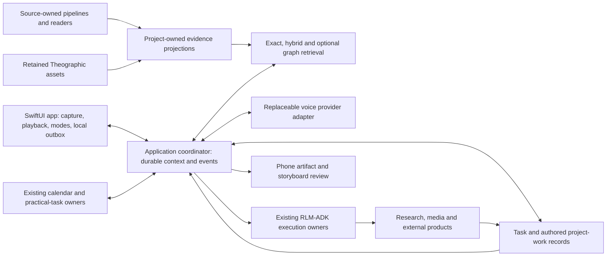

# RLM-ADK Voice Portal: Native iOS and Backend Architecture Research

Research date: October 12, 2026. Scope: source inspection and architecture research. This report proposes a design; it does not represent an implemented service, signed-device audio test, or deployed graph. The accompanying requirements and research prompt include the latest user decisions.

## Recommendation

Use the existing **SwiftUI iPhone repository** for the portal. Give the app ownership of recording, playback position, prayer boundaries, and permission to speak. Connect it to an application coordinator that holds durable conversation, task, project, reminder, and artifact state and delegates execution through existing RLM-ADK owners. A voice-provider session should be replaceable without losing those records.

The live-voice API is a foundational product component. Rawley selects OpenAI live voice as the performance gold standard for natural conversation, interruptions, and backend delegation, while making cost a significant driver of the ultimate choice. This is the target experience, not a completed universal ranking. The [live-voice landscape research prompt](live-voice-landscape-research-prompt.md) requests a fresh comparison of open-source and hybrid tooling against that reference.

Build a **source-backed knowledge service** over the existing pipeline products. Start with exact relational records, keyword/vector retrieval, and explicitly typed relationships. Use **Theographic** to supply biblical entities and passage relationships after validating its native identifiers and edition mappings. Compare a Neo4j projection against that baseline on the relationship-heavy journeys. Keep Microsoft GraphRAG as a candidate for corpus-wide synthesis and Graphiti as an optional experiment for changing personal context. Neither needs to be the operational task store.

This recommendation is an engineering judgment based on the requirements and inspected contracts. No comparative retrieval benchmark or new provider experiment was run. It would change if a small evaluation showed substantially better evidence coverage, correction handling, or maintainability with a different arrangement.

## What is established today

| Area | Evidence inspected | What it establishes | Boundary |
| --- | --- | --- | --- |
| Native workspace | `RawleySM/rlm-adk-ios`, main commit `d110bb91bd8a4b560c5d2e3744a3795cc78d8c26`; SwiftUI app, XcodeGen configuration, GitHub Mac workflows | A native scaffold exists with an unsigned simulator build/launch workflow | The UI is a placeholder; inspected configuration has no microphone usage description or background-audio entry |
| Build result | Successful cloud-mac run for that commit on October 12 | Simulator workflow succeeded | No signed-device, microphone, locked-screen, battery, or interruption proof |
| Developer enrollment | Rawley's statement that he purchased the $99 membership | Purchase is a settled requirement input | Repository documentation still describes activation/signing setup as pending; account activation, Team ID, provisioning and device installation were not checked |
| Source ownership | RLM-ADK data-source docs and data-pipelines contracts | Acquisition products and reader packages are separate from project-owned transformations | A source product being listed does not prove a consumer is using it successfully |
| Source inventory | `data-pipelines/catalog/products.json` at `4e8a5d93aa73774599045e13f2906ed7a34422e3` | Prayer corpus, YouTube, Apple raw/normalized, Chrome history, finance bronze, Scripture reference, reader packages and mirrors have catalog entries | Cornerstone is listed as planned; this was not a live health or completeness audit of every source |
| Prayer contract | Current `PRAYER_CORPUS_CONTRACT.md` v1.1 | Read-only corpus, gateway outcome and status views; source identity and change semantics | This report does not assert a current prayer count or that a new app has consumed the views |
| Project/work records | Host project docs and `RawleySM/project-work-registry` at `ba153b75aee1dbbadc93e1ec196488daa75504a8` | Authored work plans, results, checkpoints and output references have an existing design/toolkit | Read documentation does not establish adoption by every running project or a unified mobile task API |
| Current dashboard | Dashboard documentation at RLM-ADK commit `359433bad194060ee8a627acaa7ba5cd1f3094e3` | Prayer recorder/corpus proxy and read-only project views exist in the documented surface | These interfaces do not by themselves establish the durable voice, interview, knowledge and phase-event service proposed here |
| Theographic retention | Current Scripture catalog selection and observed schema | The dataset is already represented by retained source assets, including a selected verse JSON asset | Published join metadata explicitly says candidate keys only, not a tested semantic join; no integrated graph retrieval was demonstrated |

The iOS evidence is inspectable in the [pinned app source](https://github.com/RawleySM/rlm-adk-ios/blob/d110bb91bd8a4b560c5d2e3744a3795cc78d8c26/RLMADK/ContentView.swift), [project configuration](https://github.com/RawleySM/rlm-adk-ios/blob/d110bb91bd8a4b560c5d2e3744a3795cc78d8c26/project.yml), [workflow](https://github.com/RawleySM/rlm-adk-ios/blob/d110bb91bd8a4b560c5d2e3744a3795cc78d8c26/.github/workflows/cloud-mac.yml), and [successful run](https://github.com/RawleySM/rlm-adk-ios/actions/runs/38289225759). The existing authored work model is documented in the [pinned project-work registry](https://github.com/RawleySM/project-work-registry/blob/ba153b75aee1dbbadc93e1ec196488daa75504a8/project/registry/project-work/README.md).

## Native audio and voice options

Apple membership supports signed development and device distribution. It does not replace microphone permission. Apple exposes app-level recording permission through `AVAudioApplication`; registered devices and provisioning remain a distinct distribution concern. This report uses the purchase as user-reported and leaves activation/signing as an implementation check. [Apple recording permission](https://developer.apple.com/documentation/avfaudio/avaudioapplication), [Apple device distribution](https://developer.apple.com/help/account/devices/devices-overview).

Apple documents background recording with the `audio` background mode. Its recording category can still be interrupted by calls, alarms and nonmixable audio. For this app, start the audio proof with `playAndRecord`, because Scripture playback and conversational output must coexist with capture. Its default is nonmixable; evaluate the appropriate mixing and route options on the actual phone. Explicit quiet must be implemented in the app's playback behavior: the Ring/Silent switch is not a substitute, since this audio category can play while that switch is silent. [Recording category](https://developer.apple.com/documentation/avfaudio/avaudiosession/category-swift.struct/record), [Playback and recording category](https://developer.apple.com/documentation/avfaudio/avaudiosession/category-swift.struct/playandrecord).

An interruption needs an observed capture-gap record, state reconciliation and an appropriate restart. Use APIs available on the selected deployment target: the current Apple interruption article includes newer lifecycle APIs and an earlier-system interruption path. The existing project targets iOS 17; do not copy newer examples without availability checks. Ordinary background audio documentation does not prove indefinite operation across app termination or reboot. [Apple interruption handling](https://developer.apple.com/documentation/avfaudio/handling-audio-interruptions).

| Design | Fit for the desired experience | Work and limitations | Assessment |
| --- | --- | --- | --- |
| Native SwiftUI + native audio + live voice with backend delegation | Natural interviews, interruptions and transitions; the app can enforce prayer/quiet locally | Requires native audio/transport integration, reconnect handling and measured battery/latency; provider sessions are transient | Preferred interaction candidate |
| Native SwiftUI + STT → RLM reasoning → TTS | Same device capture foundation; explicit control of turns, transcript and model choice | More orchestration and potentially less fluid turn taking; latency must be measured | Credible alternative and useful independent transcription path |
| Browser/PWA or web wrapper relying on browser capture | Reuses dashboard presentation and is useful for artifact review | Does not establish the native lifecycle/audio behavior motivating this project; no Chrome implementation was benchmarked here | Supplementary review interface, not the selected capture foundation |
| Phone plus a companion recorder/compute device | Could cover recording or local-model needs the phone cannot satisfy | Adds another device and synchronization; unnecessary unless actual device evidence establishes a gap | Contingency |

OpenAI's current GPT-Live client-mode delegation is a relevant option because the conversational frontend can connect to another model or service while the application owns context and business state. The application must construct backend input from transcript events and app state; a delegation event alone is not the full request. Its documented frontend does not consume images, so storyboard frames need a separate backend vision/review path. These capabilities make the handoff plausible; they do not establish a working Swift transport or iOS background connection in this repository. [OpenAI live delegation](https://developers.openai.com/api/docs/guides/live-delegation).

Keep provider choice behind an adapter. Local or hosted reasoning can remain independent of the voice provider. Continuous recording does not require paying for continuous conversational inference: capture can persist locally while transcription and reasoning use separately chosen cadences. Offline command/wake recognition, energy use and accuracy require a device proof rather than an assumed capability.

## What the backend choices actually cover

| Candidate | Role | Best-matched needs | Main tradeoff | Recommendation |
| --- | --- | --- | --- | --- |
| Relational records + full-text/vector search | Exact data/state and retrieval baseline | Prayer lookup, sourced answers, dates, corrections, project/task state, filtered testimony context | Multi-hop relations need explicit modeling; similarity alone misses exact facts | Foundation to evaluate first |
| Theographic | Biblical entities, passages and relationships from an external dataset | People/place/event context and passage connections | Native identifiers, coverage and editorial assertions need source-specific adaptation | Reuse retained source and validate mappings |
| Neo4j + typed graph retrieval | Graph storage/traversal combined with lexical/vector retrieval | Linked Scripture context, relationship timelines and connected testimony evidence | Another derived store and synchronization path to maintain | Strong contender for the knowledge projection |
| Microsoft GraphRAG | Extracted graph, community summaries and query strategies | Broad questions such as themes across prayers or sermon collections | Additional extraction/summarization work and more complicated correction propagation | Evaluate for synthesis after the baseline |
| Graphiti | Incrementally maintained temporal knowledge extraction framework | Changing personal relationships, parts descriptions and preferences over time | Entity resolution and model-extracted claims still need evaluation/correction handling | Optional bounded temporal experiment |

The relational contender can use PostgreSQL with pgvector for vector retrieval beside full-text search. pgvector documents combining full-text and vector results with reciprocal-rank fusion or a reranker. Existing source SQLite databases stay source-owned; this recommendation concerns a consuming projection. A smaller SQLite-based projection is also credible for a first single-user prototype if it meets the same update, evidence and search checks. [pgvector hybrid search](https://github.com/pgvector/pgvector#hybrid-search).

Neo4j's retrieval library documents vector, hybrid keyword/vector, and vector/hybrid-plus-Cypher retrieval. That supports a bounded pattern: find candidate text or entities, traverse relevant typed neighbors, and return evidence. Theographic also provides graph-import documentation, so a graph pilot can use its structure rather than asking an LLM to rediscover every biblical relation. Import tooling compatibility with the chosen Neo4j edition/version still needs proof. [Neo4j retrievers](https://neo4j.com/docs/neo4j-graphrag-python/current/user_guide_rag.html), [Theographic graph documentation](https://github.com/robertrouse/theographic-bible-metadata/blob/cfb1c485d4da6fb63a69cb3b7f5b0752792f46bc/docs/neo4j-graph-documentation.md).

Microsoft GraphRAG distinguishes basic vector retrieval, local graph-plus-text search, global community-report synthesis, and DRIFT expansion. Its global strategy is suited to corpus-wide questions and is documented as resource-intensive. It is a candidate for “what has changed across my prayers over months,” rather than the default way to answer an exact oil-change date or update an appointment. Its CLI includes index updates, but that does not establish compatibility with prayer corrections or normalized-source generations without an adapter and evaluation. [GraphRAG query modes](https://microsoft.github.io/graphrag/query/overview/), [GraphRAG update CLI](https://microsoft.github.io/graphrag/cli/).

Graphiti describes temporal episodes, evolving facts and incremental graph construction. Its provenance and time modeling are relevant to life context. Treat its extracted relationships as a proposed derivative: compare entity resolution, valid-time changes and user correction behavior against manually supported records. A temporal framework's capabilities do not establish that its conclusions about Rawley's relationships or parts are correct. [Graphiti documentation](https://github.com/getzep/graphiti).

These are compatible layers. Choosing Neo4j does not require Microsoft GraphRAG; using Theographic does not require Neo4j; a graph does not replace a task ledger. The smallest useful arrangement should win the evaluation, with a graph added where it improves the user's questions.

## Theographic: reuse, adaptation and limits

The retained catalog inspected here selects 60 Theographic asset entries at revision `cfb1c485d4da6fb63a69cb3b7f5b0752792f46bc`. Its selected `json/verses.json` entry reports 37,214,043 bytes and SHA-256 `471b7d7648acd4cf5300437acd9d048514f6a5da1f34f4ce2e43ef9eeec0e858`. The published schema report counted 31,102 array records and sampled eight, observing `id`, `createdTime`, and nested `fields` such as `osisRef`, `verseID`, people and event references. Those are retained metadata/schema observations; this research did not freshly hash the entire body or validate every reference.

The selection belongs to manifest `c4ac5f4b57dd59c7a76fced2a869d02facc7e4bb72b4464ecd6506cfed2d5f31`, acquisition run `1ff6a0ff9dc14f8e87df853c06f79700`, completed October 8. The current catalog's schema authority is observed native shape and its semantic validation is explicitly not performed. Data-pipelines' source description likewise marks joins as candidate keys only, not a tested semantic join.

Theographic documents nested JSON entities, passage references and a Protestant 66-book scope. Its field documentation also identifies inconsistent or incomplete fields, including some chronology/writing-date material. That is useful evidence about dataset limits, not a reason to discard it. Preserve its foreign IDs, inspect the actual selected files, and distinguish editorial historical assertions from verse text. Do not infer a Scripture text's edition from an OSIS reference alone. [Theographic JSON field documentation](https://github.com/robertrouse/theographic-bible-metadata/blob/cfb1c485d4da6fb63a69cb3b7f5b0752792f46bc/docs/json-fields-documentation.md).

Propose an adapter that returns a source-qualified biblical entity, aliases, typed relation, passage anchor and supporting asset revision. Validate missing endpoints, duplicate references, edition/versification mappings and date precision. Biblical and personal entities need separate identities: a personal relationship and a biblical person sharing a name are not evidence of identity. Keep dataset attribution and license metadata with derivatives. The publisher labels the project CC BY-SA 4.0; examine the applicable source terms when planning a shared derivative output. [Theographic repository](https://github.com/robertrouse/theographic-bible-metadata).

Theographic will not by itself supply fair Calvinist/Arminian comparisons, Rawley's life application, a parts map, or current appointments. Those need attributed teaching/interpretation sources, personal evidence, and operational records respectively.

## Proposed organization over the existing pipelines

The consumer needs stable evidence records before higher-level extraction. The following are proposed projection contracts, not claims that these schemas already exist:

| Record | Essential content | Purpose |
| --- | --- | --- |
| Source revision | Source/native identity, revision or text digest, observation time, locator, reader generation | Reconstruct what an answer or project used |
| Text segment | Source revision, character/time span, exact text, chunking version | Cite search and extraction results |
| Entity and alias | Typed identity, namespace, aliases, supporting spans, user corrections | Connect context without silent name-based merges |
| Claim or relationship | Predicate, participants, supporting spans, assertion kind, attribution, temporal precision, correction history | Distinguish Scripture, teacher interpretation, personal reflection and extracted suggestion |
| Passage mapping | Source/edition/versification, native reference, mapped reference, validation state | Preserve Scripture identity across collections |
| Task/project/artifact reference | Stable operation/work/project ID, phase, revision, input request, artifact location and result evidence | Preserve acknowledged work independently of retrieval |

Consume prayer `prayer_corpus_v1`, `prayer_gateway_outcomes_v1`, and `prayer_corpus_status_v1` through their published contract. A prayer's text can change without its listing timestamp moving; compare `text_sha256`, reconcile membership/removals, and retain the cited revision. Do not discover corrections only by asking for rows newer than the last listing timestamp. [Current prayer contract](https://github.com/RawleySM/data-pipelines/blob/4e8a5d93aa73774599045e13f2906ed7a34422e3/pipelines/prayer_ingest/docs/PRAYER_CORPUS_CONTRACT.md).

Apple normalized readers require the generation plus their change cursor to capture late payload repairs; raw gateway sequence alone is insufficient. YouTube observations retain selected-body changes and extraction/fetch metadata. Scripture readers resolve manifests and hash-qualified text locators and deliberately leave semantic mapping/interpretation to consumers. Each adapter should atomically advance its consumer cursor with the projection update, then invalidate affected chunks, embeddings, relations and summaries. Keep old evidence reconstructible and prevent superseded derived content from answering as current context. [Life-source readers](https://github.com/RawleySM/data-pipelines/blob/4e8a5d93aa73774599045e13f2906ed7a34422e3/packages/life_source_readers/README.md), [Scripture readers](https://github.com/RawleySM/data-pipelines/blob/4e8a5d93aa73774599045e13f2906ed7a34422e3/packages/scripture_reference_readers/README.md), [YouTube source contract](https://github.com/RawleySM/data-pipelines/blob/4e8a5d93aa73774599045e13f2906ed7a34422e3/pipelines/youtube_ingest/README.md).

Route queries by need. “When was my last oil change?” should use supported maintenance events ordered by date. “What have I prayed about Creighton?” should combine exact identity/date filters with semantic search and optionally connected events. “What surrounds this verse?” should use a mapped passage and biblical relations. “Where do traditions disagree?” should retrieve attributed interpretive passages and compare them. A large cross-domain research request should become tracked work with an artifact, while calendar prep and phase changes should use operational events.

Keep acquisition/transcription/mirroring in data-pipelines and source owners. Put domain adapters, knowledge projections, retrieval and personal application in an authored project/service. Keep generic execution, runtime identity and factual host receipts in RLM-ADK. Reuse project-work records for suitable work/output references and add the minimum application adapter for small tasks, interviews, priorities and notifications. Inspected contracts support these boundaries; they do not establish a complete unified portal backend already running. [RLM-ADK source ownership](https://github.com/RawleySM/rlm-adk/blob/359433bad194060ee8a627acaa7ba5cd1f3094e3/rlm_adk_docs/data_pipeline_sources.md), [data products](https://github.com/RawleySM/data-pipelines/blob/4e8a5d93aa73774599045e13f2906ed7a34422e3/catalog/products.json).

## Proposed components and interaction state

```mermaid
stateDiagram-v2
    state "Independent application concerns" as App {
    state "Capture lifecycle" as Capture {
        [*] --> Recording
        Recording --> CaptureGap: OS interruption or unavailable microphone
        CaptureGap --> Recording: verified recovery
    }
    --
    state "Engagement policy" as Engagement {
        [*] --> Available
        Available --> Conversing: user request or allowed proactive event
        Conversing --> Available: exchange finishes
        Available --> Quiet: explicit quiet
        Conversing --> Quiet: explicit quiet
        Quiet --> Available: explicit wake
        Available --> Prayer: explicit prayer capture
        Conversing --> Prayer: explicit prayer capture
        Quiet --> Prayer: explicit prayer capture; retain quiet state
        Prayer --> SaveAndWait: explicit prayer end
        SaveAndWait --> Available: saved; prior state allowed speech
        SaveAndWait --> Quiet: saved; prior state was quiet
    }
    --
    state "Work lifecycle independent of speech" as Work {
        [*] --> Recorded
        Recorded --> Accepted: execution owner acknowledges
        Accepted --> Running
        Running --> NeedsInput
        NeedsInput --> Running: user provides details
        Running --> OutputReady
        Running --> Failed
        OutputReady --> Reviewed
    }
    }
```

Every playback path checks the current local engagement state. Entering quiet or prayer stops existing playback and suppresses queued speech; a deferred calendar event does not switch modes. Ending prayer saves and waits. Returning to the prior quiet state after a prayer is a proposed clarification, consistent with quiet requiring explicit wake, and should be confirmed during interaction implementation. Source capture and server-side work continue independently when available; actual capture gaps remain visible.

Available conversation must also avoid talking over the user or other conversations. Availability inference is still open. Begin with deterministic quiet/prayer behavior and a conservative conversational policy, then evaluate additional inference without changing the explicit quiet/wake rule. This is interaction behavior, not a new security or isolation architecture.

## Proposed interfaces and event semantics

Use an HTTP command/result interface and a resumable event stream as the initial protocol candidate. Exact routes are undecided. An SSE or WebSocket connection can communicate events while usable, but persistent server work must not depend on its lifetime. Phone background event delivery needs device testing; it cannot be assumed from a server's ability to publish an event.

| Interface | Proposed semantics |
| --- | --- |
| Capture segment | Stable segment ID, start/end time, format, digest, local durability state, upload acknowledgement, prayer/session association and explicit gap markers |
| Context selection | Active passage plus edition, actual playback position, project/artifact revision and selected evidence references |
| Voice instruction | Operation ID, originating turn/command, relevant context and requested action; retries preserve the same operation ID |
| Task acknowledgement | Distinguish locally queued, durably recorded, accepted by an execution owner, running and failed; speak only the status actually established |
| Work event | Event ID/cursor, operation/project ID, revision, phase and reason; include requested user input and stale/superseded state |
| Artifact available | Artifact revision/location/media type and evidence of actual availability; production completion is distinct from phone delivery or review |
| Reminder | Source commitment, due/prep/departure time, speech eligibility, expiry, deferred state and handling after wake |
| Mode state | Locally immediate quiet/prayer behavior and revisioned persisted state; reconcile reconnects before replaying audio |
| Resume | Client supplies last consumed event cursor and pending operation IDs; reconcile acknowledged results rather than create duplicate work |

When offline, “saved locally and waiting to submit” is truthful; “RLM-ADK accepted the research” requires the corresponding backend acknowledgement. A host receipt alone cannot mark a produced report as reviewed or a ministry site as delivered. Map existing owner/registry semantics instead of introducing a competing orchestration system before verifying the missing pieces.

For calendars, verify source freshness and the existing Apple Calendar write owner before scheduling. For media, inspect the current project-specific draft/interview/storyboard/render handoffs during implementation discovery. The report has not proved those handoffs end to end. Practical tasks should use established execution authority and standing preferences; research authorization here is not authorization to make a booking, purchase, tax filing or publication.

## Requirements traceability and evaluation

| Requirement group | Proposed support | Existing evidence to reuse | Proof still needed |
| --- | --- | --- | --- |
| DEVICE, VOICE, MODE | Native capture, local playback/mode state, voice adapter, outbox | iOS scaffold; Apple audio APIs | Signed phone, locked screen, long prayer silence, quiet across reconnect and interruption |
| SCRIPTURE and DATA | Versioned evidence projection, passage mapping, hybrid/typed retrieval | Scripture reader contract and retained Theographic | Correct joins, viewpoint coverage, citations and correction behavior |
| RESEARCH and PROJECT | Durable operations and work/result references | Host execution and authored work-registry contracts | Accepted request survives session end and yields an actual accessible result |
| CREATIVE and MINISTRY | Evidence-backed draft, resumable interview, artifact revisions | Existing project/media owners to inspect | First draft → interview → storyboard → real phone-reviewable artifact |
| PROACTIVE and LIFE | Schedule/task records, eligible phase events, deferred reminders | Apple source products; current write owner to verify | No speech in quiet/prayer; correct departure/maintenance data and stale-event handling |
| PARTS | User-defined typed entities and temporal attributed reflections | Prayer/life-context source readers | User-corrected mapping persists without becoming an unsupported clinical assertion |

Compare retrieval designs on the same bounded source selection and queries. Include exact dates, Creighton relationship lookup, a passage with two attributed theological readings, Theographic entity traversal, prayer correction, late source repair, parts-description change and broad theme synthesis. Review supporting spans and missing evidence, not only fluent answers. Record latency, index/extraction effort, incremental rework, ongoing operating burden and unsupported claims. No fabricated numeric rankings are assigned here.

The nearest alternative to the recommended foundation is a Neo4j-centered knowledge projection alongside a relational operational store. Prefer it if multi-hop retrieval materially improves supported answers and correction propagation is maintainable. Prefer Microsoft GraphRAG more broadly if corpus-wide synthesis dominates use and its measured quality gain justifies indexing/query work. Prefer a temporal framework if evolving facts are frequent and it demonstrably preserves user corrections and source time. A relational/hybrid design remains viable if those gains are small.

## First journey and phased proof plan

1. **Device/audio proof in the existing repository.** Verify membership/signing readiness and install on the target iPhone. Configure permission/background audio and a durable local recorder. Exercise screen lock, another app, speaker/headset routes, quiet, prayer pauses, network loss and an audio interruption. Record duration, gaps, restart behavior, power and storage. This proves only the tested device/OS conditions, not indefinite capture.
2. **One complete voice-to-work journey.** Play a verse/devotional, interrupt for historical context, start a prayer with a long pause, end/save/wait, then ask for a testimony draft about Creighton. Record the action item, end the voice connection, resume, complete an interview and open a real draft or storyboard. Reuse the existing production process for a later media output; do not mark a storyboard as a finished film.
3. **Consumer projection and retrieval comparison.** Implement a small read-only source consumer and a relational/hybrid baseline. Validate Theographic mappings on selected passages. Compare a Neo4j projection, then global synthesis/temporal tooling only on questions requiring those capabilities. Measure corrected-source propagation and cite original spans.
4. **Schedule and phase-event delivery.** Use the verified calendar owner and a project phase needing input. Let timers/events fire during available, quiet and prayer states; test wake, stale reminders and reconnect. Prove ordinary status remains on request and quiet is never overridden.
5. **Expand work types and long-term context.** Add practical responsibilities, parts mapping, broader ministry/book projects and more production artifacts through reusable project interfaces. Add advanced availability inference after the explicit controls and ordinary journeys work.

These are proposed implementation/evaluation steps, not tests run in this research. Keep the first journey small while preserving the general project capability.

## Resource considerations and unresolved decisions

Treat ChatGPT Pro subscription usage and application API usage as separate budgets. API pricing is separate from subscription usage; do not assume Pro funds this app's API calls. The applicable API billing/credit arrangement still needs to be verified for implementation. [OpenAI pricing distinction](https://learn.chatgpt.com/docs/pricing).

GPT-Live's active session accounting includes silence and backend waits; muting does not close a session. Preserve continuous local recording and mode state independently of paid session lifetime. Session/reconnection policy must also preserve natural conversation and allowed proactive prompts. [Voice cost accounting](https://developers.openai.com/api/docs/guides/voice-latency-cost).

The current published `gpt-live-1` voice rate is **$0.05 per active minute**, billed per second, with backend usage charged separately. For a 30-day month, the following are illustrative voice-session subtotals; refresh the rate during selection and add reasoning, tools, transcription, storage and compute. They are not measured usage or a complete app budget. [OpenAI GPT-Live pricing](https://developers.openai.com/api/docs/pricing).

| Assumed active session time per day | Active minutes per 30-day month | Voice-session subtotal |
| --- | --- | --- |
| 30 minutes | 900 | $45 |
| 2 hours | 3,600 | $180 |
| 8 hours | 14,400 | $720 |
| 24 hours | 43,200 | $2,160 |

The main resource variables are recorded hours and codec, transcription cadence, live-conversation hours, retrieval corpus size, extraction frequency, source-change volume and local/hosted model placement. Budget voice inference separately from always-on recording, and index only changed source revisions when the contract supports it. Graph extraction and community summaries add work beyond storing and searching text; their value should be measured. The table is a conditional arithmetic illustration; no total monthly app cost or provider throughput guarantee is asserted without a selected workload and evaluation.

For scale illustration only, uncompressed mono audio at 24 kHz and 16 bits is approximately 172.8 MB/hour, or 4.15 GB per 24-hour day, before container overhead. That is arithmetic under an assumed format, not the selected recording format; compression, retention and power must be tested. Decide raw audio versus transcript retention and playback needs before sizing storage.

Remaining choices are target iPhone/iOS and signing readiness; wake/quiet phrases and prayer controls; recording format/retention/transcription cadence; voice provider/transport and inference placement; precise devotional/translation sources; silent/haptic delivery; standing task preferences; and which existing project/media/calendar owners supply each adapter. None prevents the architecture comparison, but each affects implementation acceptance.

All external documentation linked above was accessed October 12, 2026. Apple article bodies were read through Apple's official documentation Markdown endpoints because browser extraction returned only the JavaScript shell. Repository findings are pinned to the commits shown. Source-catalog counts and hashes are observed retained metadata, not fresh body-integrity or semantic-acceptance claims. No running service, pipeline, source database, signing account, or GitHub runner was modified by this research.
