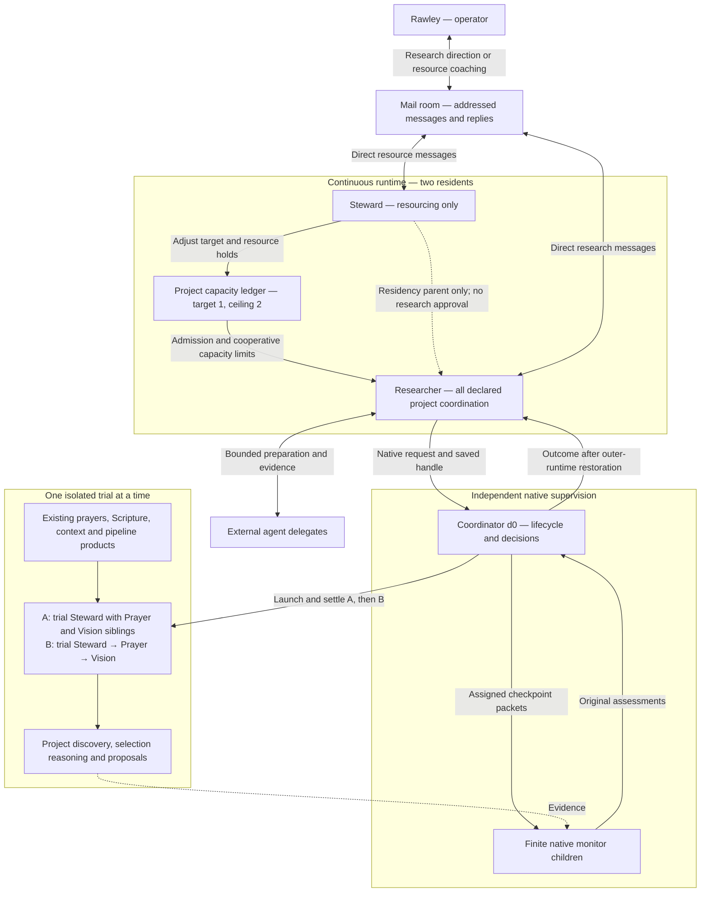

# Minimal next launch: Steward + Researcher

Proposed 2026-10-14. This is the preferred **stripped-down next-cycle option**,
following the broader [Researcher proposal](researcher-resident-proposal.md).
It replaces that option's outer roster with exactly two residents. The earlier
Intake/Researcher node fragments are not a complete authoring file for this option.
The two-resident runtime was installed and admitted on 2026-10-14. Its actual
assignment ledger and direct mail replies match this design. The initial A/B
campaign is in preparation; completed experiments are not yet claimed. See the
[attended bring-up record](minimal-research-launch/LIVE_BRINGUP.md) for selected
source, installation, live evidence and the failed eight-monitor timing drill.

## 1. Two continuing residents, one serial improvement campaign



The dotted Steward-to-Researcher edge is residency structure, not a conversational
approval path. Rawley talks directly to either resident through the existing
instance mailbox. Both reply directly to `operator`. Steward does not select
research questions, approve experiments or judge adoption recommendations.
Messages can be queued while production is paused; resident delivery and action
wait for execution to resume. Emergency intervention during a trial uses the
independent lifecycle owner, not mail to a paused Steward.


The last three residents are the **baseline trial**, not additional residents
in the outer launch. Alternative constructions replace the trial's authored
topology. Intake is deferred from this outer runtime. The voice portal must not
be left addressing an undeclared Intake ID; its resident request path needs an
explicit temporary destination or truthful unavailability behavior.

The outer Steward manages only resourcing. Researcher receives its campaign in
launch steering and later direct operator mail, maintains the opportunity list,
uses delegates to prepare candidates and launches a single supervised experiment
at a time without Steward approval. The independent coordinator owns monitoring
and settlement. Neither outer resident duplicates the prayer pipeline.

The recursion is: **a native resident commissions a native supervised runtime,
learns from its results, and commissions the next variant**. Initially there is
one experiment level. A trial must not recursively acquire another live-test
lease against the same production installation: the existing exclusive lease
refuses that. Arbitrarily nested live-test installations are unnecessary here.

## 2. Small launch declaration

Recommended authoring choices, to resolve against actual resources before sealing:

| Setting | Choice |
|---|---|
| Format and instance | New `rlm-launch-v2` instance with new resident registry/spec/workspace/package roots |
| Outer Steward | Name Steward, proposed new ID `stwlab`, package `steward_stwlab`, cold formation with the resourcing-only mission |
| Researcher | ID `rsch01`, package `researcher_rsch01`, cold child of Steward, `hold_until: parent_running` |
| Outer resident limits | Total 2, active 2, maximum direct children 1; these limits do not govern the separate coordinator or trial |
| Outer project capacity | Initial target 1, ceiling 2; Rawley can coach Steward to raise the target later without changing the ceiling |
| Outer projects | `runtime-improvement` plus the five currently pinned domain project grants; candidate host-code work is deferred from this A/B pair |
| Project coordination | Researcher holds **every configured outer project slot**; Steward holds none |
| Capacity governance | Steward |
| Project registration | Disabled in this draft: the one new repository is enrolled at launch; no runtime registrar is needed |
| Production model-routing control | Explicitly disabled initially; trial model policies are versioned experiment inputs |
| Installed-release activation | Explicitly disabled initially; external coding agent/operator performs updates |
| Project promotion execution | Explicitly disabled initially; Researcher returns exact adoption recommendations to the external owner |

All six duty kinds must still be explicitly declared and adopted, including the
disabled kinds. “Every project slot” is an explicit finite set, not a wildcard.
If additional existing repositories are included as coordinated outer projects,
their slots also go to Researcher. Ordinary read/source access need not create a
new coordinated project. The parent must carry the access its child requests.

Researcher can own several slots while only one branch is open. During an
experiment it uses `project:runtime-improvement`; a delegate can build a harness
candidate in a granted isolated worktree from that coordinate, retaining the
distinction between sponsor identity and target repository. If a separate harness
coordinate is needed, use it sequentially after settling the first branch. A Git
worktree alone never establishes a capacity attachment.

The new outer Steward identity avoids reusing the old domain Steward's package
head for a different cold mission. Preserve the old Steward, Prayer and Vision
packages for exact warm reuse inside trials. Validate all proposed IDs before use.
Historical candidates were Steward v11, Prayer/Life Context v2 and Discipleship
Vision v2; resolve their actual immutable versions and adoption compatibility
again, rather than selecting unqualified `latest`.

## 3. Two short resident missions

**Steward:** Govern resources through the capacity ledger. Start with one outer
project entitlement, monitor available factual resource evidence between trials,
reduce admission when necessary, and respond directly to Rawley's resource
coaching. Keep the target at one initially; a ceiling of two permits a later
operator-directed increase. Do not mediate research, evaluate project proposals
or require messages from Researcher. Capacity contraction is cooperative: it can
hold work and retain occupied attachments; it does not immediately free physical
resources or terminate the independent experiment.

**Researcher:** Begin the supplied two-topology A/B campaign without awaiting
another instruction. Use existing pipelines/products and delegates to prepare
and run the experiments, evaluate both project-selection reasoning and proposed
projects, then return evidence and recommendations directly to Rawley through the
mail room. Respect actual capacity, preserve outcomes and wait for direct coaching
after the initial pair. The Steward's role is resource availability, not approval.

Exact enduring instructions and startup steering are now prepared in the
[minimal launch bundle](minimal-research-launch/LAUNCH_READINESS.md), including a
complete [draft launch](minimal-research-launch/launch.author.json). They supersede
the older Intake-inclusive node for this launch.

The opportunity queue and comparison records belong in the authored research
project. Start with a README, a small opportunity list, per-attempt input/evidence
directories and a decision log. Reuse any existing project-register interface;
neither another host registry nor a new duty kind is needed.

## 4. The first campaign: prayers to actionable project options

Use a fixed, representative prayer snapshot and explicitly selected context,
existing pipeline code, skill versions and prior products. Inventory the actual
bronze/silver/gold contracts before execution. The following is the **evaluation
intent**, not a claim that a particular current pipeline already emits every field:

```text
Prayer source evidence
  -> grounded interpretation and relevant context
  -> gold-level synthesis
  -> distinct, supported project options
  -> Rawley's discernment and a possible next action
```

A candidate project option should explain its motivating prayer evidence, the
need/opportunity, who might benefit, the proposed useful outcome, a concrete first
step, resources/dependencies, uncertainties and how the work's benefit could be
observed. Distinguish prayer content, supporting context and agent interpretation.
Not every prayer needs to become a project; a justified “no project proposed” is
preferable to manufacturing work. A gold label is not semantic acceptance.

Run these variants sequentially, stopping if the baseline itself is not valid:

| Trial | Construction | Question |
|---|---|---|
| A: baseline | Trial Steward with Prayer and Discipleship Vision as children, exact existing packages | What useful options does the current construction actually produce from the selected prayers? |
| B: topology variant | Trial Steward → Prayer → Discipleship Vision, preserving comparable source inputs, methods and goals | Does sequential resident ownership produce better project-selection reasoning and project options than sibling coordination? |

These are research hypotheses, not promised improvements. Package peer references,
grants and formation/launch rules must be valid for each construction. Preserve
the baseline and candidate launch documents and exact differences. Do not change
topology, model, package and source code together in the first comparison. Explore
model or host-code changes afterward when observed evidence motivates them.

Ask whether the outputs are grounded, distinct, substantive, feasible and more
useful to Rawley, and whether they reduce his interpretive/repair burden. Preserve
counterexamples and missing evidence. Compare resource use and elapsed time with
coverage limitations; do not count overlapping token observations twice or turn
subscription capacity into invented dollar costs. Test a promising result on a
second prayer sample before calling it a reusable improvement.

Rawley supplies judgments about actual usefulness and mission fit. The system
must not infer spiritual fruit from output volume or fabricate his approval.

## 5. The actual serial lifecycle

1. Launch steering supplies Rawley's initial campaign; Researcher opens its one sponsoring coordinate as admitted by the capacity ledger. No Steward conversation is needed.
2. Delegate work produces a complete request: pinned source/interpreters, trial
   launch, model policy, package/data references, acceptance and stop conditions,
   outcome recipient `rsch01` and an applicable monitoring qualification.
3. Researcher calls `start_live_test_experiment` from its accepted native work,
   persists the immutable request/handle and retains its attachment. A pending
   handle is not proof of accepted supervision; unchanged retries reuse the ID.
4. The accepted independent coordinator pauses production through the existing
   allocator owner, launches the trial and runs finite monitor batches. Initially
   use a measured 300-second checkpoint interval and ordinary 150k compaction.
5. Coordinator decisions lead to continuation or exact stop/settlement, followed
   by restoration of the captured outer baseline. While production is paused,
   **both outer residents are paused**. They are not concurrently researching.
6. Researcher consumes the outcome, reconciles missed notices by saved handle,
   assesses semantic success and releases the outer coordinate only after trial
   and ordinary coordinate work are settled. Then it can take the next attempt.

The coordinator/trial project capacity is separate from the one outer entitlement.
Trial-local Steward retains its own declared capacity duties; Researcher's outer
coordination assignment does not confer authority inside the trial. Native monitor
children consume their execution resources, not extra outer project slots.

The current implementation does not automatically attach an independent experiment
as a settlement dependency of the sponsor project. For this small first cycle use
the attended serial convention above; do not retire/reassign the Researcher or
close its sponsor during unresolved work. Explicit cancellation goes through the
qualified coordinator/lifecycle owner, not an outer branch hold. An unknown or
`cleanup_pending` result blocks the next attempt. Broader unattended retirement
and restart recovery stays an open item, not a prerequisite to redesign the host
before proving this bounded path.

## Resource observations for the first A/B pair

Two trials means A then B, not two simultaneous trials. The outer target starts
at one with a ceiling of two. Raising the target later allows additional outer
project work; it does not defeat the exclusive live-test lease or raise trial
capacity. Trial project limits and provider child/concurrency settings remain
separate, explicit inputs.

Use retained subscription snapshots and token evidence, plus a small external
read-only GPU sample during the attended experiment. Codex has a non-inference
account reader; Claude observations are stream-derived; Grok capacity coverage
is currently unsupported. Snapshot polling is on 300-second boundaries where
owned; stale values remain stale. Account changes include unrelated clients and
are not exact experiment consumption or a dollar invoice.

GPU evidence must identify the actual inference host and device, timestamp,
loaded models or owner process when observable, allocated/used memory, utilization,
failures and availability. Report baseline and sampled peak; unavailable VRAM on
a unified-memory platform stays unknown or uses separately labelled supported
memory evidence. Resident token counts do not reveal device memory pressure.
A project target is a coarse admission lever, not a GPU-memory control knob.

While the outer runtime is paused, its Steward cannot react to live observations.
The independent coordinator and external supervisor own in-trial observation and
stop. Steward uses staged fresh observations after restoration, or acts on direct
operator resource mail. No claim of an autonomous in-trial VRAM controller is
made. The [readiness dossier](minimal-research-launch/LAUNCH_READINESS.md) gives the
small evidence bridge and first-run qualification instead of introducing a new
monitoring service.

## 6. Promotion kept outside the first loop

The Researcher returns a compact comparison and an exact recommended launch,
instruction, model-policy, skill or code candidate directly to Rawley. Rawley
provides mission and adoption direction. An external coding agent/operator applies
the appropriate supported publication/update workflow, then Researcher checks
whether ordinary work exhibits the expected benefit.

This first cycle therefore proves **native research, experiment initiation,
independent supervision, outcome interpretation and retained learning**. It does
not claim fully autonomous production self-update. Add native promotion and an
independent installer consumer only after repeated experiments justify them.
Existing activation requests are narrower than arbitrary topology replacement:
captured launches currently require the same instance and retained assignments.

## 7. What must be ready for this launch

Only the relevant subset of [Researcher open items](Researcher_Open_Items.md)
applies: R-01–05 (with this two-resident roster replacing the Intake roster), R-07–15
for the first live experiment, and exact artifact adoption when choosing a winner.
R-06's Intake assembly work is deferred; update its voice routing expectation
instead. Autonomous installer and broad sponsor recovery work remain later gates.

Before activation: coordinate with the current allocator owner; preserve current
data, published packages and unpublished work; resolve actual projects and source
snapshots; build and preflight the complete two-resident V2 authoring document
against the candidate release. Install through foreground `allocatorctl update`
with an explicit `--launch` and a qualified main-line commit. No full reset is
required just to establish this new instance.

Before the first trial: verify installed native protocol 1 and finish the existing
actual-provider initiation/supervision/settlement proof with external attendance.
Do not treat the successful no-trial timing drill as live semantic acceptance.
Shared lifecycle-owner bytes must match between coordinator and trial, so initial
experiments change topology/instructions rather than the supervising machinery.

The companion `minimal-research-launch/launch.author.json` is a complete,
schema-validated draft using observed existing paths and project revisions. It is
not installed or operationally preflighted. The research repository and bootstrap
files must be staged, gateway policy and skill-installation compatibility checked,
and the original A/B inputs prepared before activation. Do not concatenate the
older broad fragments into this selection.

## Source basis

Checked against the native-supervision implementation merged at
`d6a0871058fe491a7f06d1b906ccd3a281724d36`:

- [Project capacity and explicit coordination](https://github.com/RawleySM/rlm-adk/blob/d6a0871058fe491a7f06d1b906ccd3a281724d36/rlm_adk_docs/projects/project_branches.md).
- [Native initiation, independent supervision and outcome contracts](https://github.com/RawleySM/rlm-adk/blob/d6a0871058fe491a7f06d1b906ccd3a281724d36/rlm_adk_docs/native_live_test_supervision.md).
- [First V2 instance and preservation](https://github.com/RawleySM/rlm-adk/blob/d6a0871058fe491a7f06d1b906ccd3a281724d36/rlm_adk_docs/assignment_v2_runtime_handoff.md).
- [Allocator's exclusive trial lease](https://github.com/RawleySM/rlm-adk/blob/d6a0871058fe491a7f06d1b906ccd3a281724d36/rlm_adk/host/cli.py).

Source reading establishes these constraints; no live state or trial was changed
or newly tested while preparing this option.
