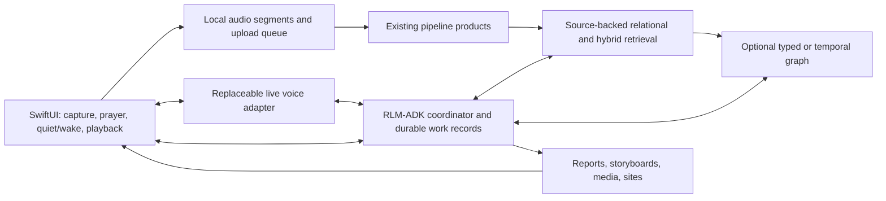

# RLM-ADK Voice Portal: Top Candidates

Decision brief • October 12, 2026 (America/New_York; source checks continued October 13 UTC)

**Recommended direction:** native SwiftUI capture and interaction controls; **OpenAI GPT-Live with client delegation** as the conversational benchmark; **Pipecat** as the first open-source voice framework to evaluate; and a **PostgreSQL + full-text + pgvector** consuming backend over the existing data pipelines. Reuse **Theographic** for biblical reference relationships. Compare **Neo4j** on relationship-heavy questions before making a graph database central to the design. Keep existing RLM-ADK execution owners responsible for durable work.

This is a ranked synthesis of the [user requirements](user-needs-and-requirements.md), the [earlier architecture inventory](architecture-research.md), and **seven archived Gemini reports**. Five studies remain unarchived in the [research manifest](research/2026-10-12-gemini/manifest.json), including dedicated economics, evaluation, retrieval, integration, and durable-work studies. Their missing findings are not assumed here. Rankings are engineering judgments about this private, single-user application, not results of device tests or a comparative benchmark.

## 1. The shortlist at a glance

Rankings apply within a layer; these components serve different purposes and can work together.

| Decision | First candidate | Closest alternative | Why it leads / what could change the choice |
| --- | --- | --- | --- |
| Phone foundation | **SwiftUI + native audio, locally persisted mode/capture state** | Companion capture device if the phone fails the recording proof | Matches the existing repository and eyes-free goal. Signed-device results decide achievable continuity. |
| Conversational experience | **OpenAI `gpt-live-1`, client delegation to RLM-ADK** | Realtime mini or a modular speech pipeline | Closely matches free-flowing interviews with independent backend reasoning. Cost and measured interaction quality decide production use. |
| Open-source voice framework | **Pipecat**, Swift client and a tested transport/service combination | **LiveKit Agents + Swift SDK** | Good fit for comparing providers and cascaded speech in a Python environment. LiveKit can win on integration reliability and operating effort. |
| Open-weight full-duplex experiment | **NVIDIA PersonaPlex**, hosted on suitable backend hardware | **Kyutai Moshi** as a reference baseline | Promising simultaneous listening/speaking and role control. Hardware performance and reliable backend handoffs remain unproved. |
| Knowledge foundation | **PostgreSQL + full-text + pgvector**, with explicit source revisions and typed links | **Neo4j** knowledge projection alongside operational records | Covers exact facts, evidence retrieval, corrections, and incremental consumption with fewer moving parts. Neo4j wins if traversal substantially improves supported answers. |
| Biblical reference | **Theographic**, adapted from retained source assets | Additional reference datasets for demonstrated coverage gaps | Directly serves people/place/passage relationships. It is a dataset, not a replacement for the database or interpretation sources. |
| Evolving personal context | **Explicit temporal records and attributed assertions** | **Graphiti** as a derived temporal graph | Preserves user corrections and source history. Graphiti merits a bounded test when automatic temporal extraction reduces useful work without losing fidelity. |
| Broad corpus synthesis | **Targeted retrieval first** | **Microsoft GraphRAG** for corpus-wide themes | Start with the user's immediate questions; add community-summary retrieval when broad synthesis shows a measurable benefit. |
| Tasks, reminders, projects | **Extend existing RLM-ADK owners and work records with a mobile-facing adapter** | A new workflow engine only after a documented gap | Avoids duplicating execution ownership. A voice session or retrieval index cannot serve as the job ledger. |

## 2. The architecture these choices imply

These are logical responsibilities, not a requirement to deploy a separate service for every box. The app owns the immediate decision to emit sound. The backend keeps doing authorized work while the app is quiet. Recording, transcription, paid voice sessions, permission to speak, and job execution have separate lifecycles.

The first complete journey should be: morning verse/devotional → spoken question → prayer with a long pause → explicit save and wait → testimony request about Creighton → durable acceptance → interview → actual draft/storyboard available on the phone. A later render can produce a video; a storyboard is not a completed film.

## 3. Native iOS and live voice

### Native capture: selected direction, device feasibility still open

Use this repository's SwiftUI foundation and evaluate `AVAudioSession.playAndRecord` with a durable local recording path, controlled playback, and background audio configuration. Apple documents playback and recording together, including background operation, and separately documents interruptions. The proposed design must record capture gaps and reconcile audio routes and playback state after interruption. [Apple audio category](https://developer.apple.com/documentation/avfaudio/avaudiosession/category-swift.struct/playandrecord), [interruption handling](https://developer.apple.com/documentation/avfaudio/handling-audio-interruptions).

Rawley's reported $99 Apple Developer Program purchase supports the native-device direction. It does not establish account activation, signing readiness, successful installation, or unrestricted microphone operation. The earlier inventory established a scaffold and simulator workflow; it did not establish continuous phone recording. A Live Activity is not accepted here as proof of indefinite background execution.

| Interaction rule | Required behavior in every candidate |
| --- | --- |
| Ordinary availability | Natural conversation, interruptions, and context changes; ordinary project status on request. Initial proactive speech covers calendar preparation/departure and project phases needing attention. |
| Explicit quiet | Continue desired recording and backend work; suppress agent speech until explicit wake. Reconnection, timers, and project events cannot clear quiet. |
| Prayer capture | Record through long pauses; no agent replies and no silence-triggered ending. An explicit control ends capture. |
| Prayer finished | Save and wait for the next user request. Do not automatically speak a reflection, start a project, or force entry into explicit quiet. If explicit quiet was already set, preserve it until wake. |
| Interrupted playback | Retain the passage/artifact revision and what was actually heard, not merely all text generated by the model. |

Implement these rules in application state and playback controls. A prompt asking a model to remain silent is insufficient to establish the behavior. Continuous recording remains the requirement; any operating-system gap must be represented honestly. Availability inference beyond explicit controls remains an open design question.

### Voice models: benchmark, economical challenger, local experiment

**First: GPT-Live with client delegation.** OpenAI documents full-duplex conversation and a client-delegation mode that connects an existing agent or service. That fits RLM-ADK better than moving all reasoning and project ownership into the voice provider. Use the exact model/API as the reference implementation for naturalness, interruptions, corrections, and delegation. “Gold standard” is Rawley's chosen performance target, not a claim that testing has proved universal superiority. [GPT-Live guide](https://developers.openai.com/api/docs/guides/live).

**Second: a cost-focused challenger.** Compare `gpt-realtime-2.1-mini` and a modular STT → existing reasoning → TTS path on the same journeys. A cascade offers independent component selection, but its conversational timing and interruption behavior must earn acceptance. A smaller model's lower rates do not prove lower total task cost if it requires retries or longer conversations. Model choice for deep research can remain independent of the voice layer.

**Third: PersonaPlex on backend hardware.** NVIDIA describes a full-duplex speech-to-speech model with text role prompts and audio voice conditioning. This is the leading open-weight experiment from the reports, not a ready replacement for the complete agent interface. Its code is MIT-licensed; its weights use the **NVIDIA Open Model license**, correcting the archived report's CC-BY attribution. Test hardware/runtime compatibility, sustained throughput, tool handoffs, and operating cost before promotion. No iPhone deployment or DGX Spark performance has been demonstrated here. [NVIDIA publisher repository](https://github.com/NVIDIA/personaplex).

**Moshi is the comparison baseline.** Its publisher describes dual audio streams and provides several implementations, including an MLX path. Published latency on a specified GPU or an Apple Silicon implementation does not establish equivalent latency, thermal behavior, or background execution on the target iPhone. [Kyutai Moshi](https://github.com/kyutai-labs/moshi).

The reports also name Qwen Omni, Ultravox, GLM-4-Voice, and smaller research systems. They remain a watchlist: this synthesis does not accept the reports' release dates, licenses, or timing comparisons without a current artifact check. The remaining VOICE-4 study may change this ordering. The recommendation is not an exhaustive claim about the newest open models.

### Frameworks: Pipecat first, LiveKit a serious alternative

**Pipecat is the first integration candidate.** Its documentation establishes a Swift client, modular transports, and an `OpenAILiveLLMService` with client delegation. Its SmallWebRTC Swift package documents a peer connection to the corresponding backend transport. This makes it a practical candidate for a single-user Python-backed portal and for later provider comparisons. The RLM-ADK adapter still needs to convert delegated conversation/context into a durable request. [Swift SDK](https://docs.pipecat.ai/api-reference/client/ios/overview), [SmallWebRTC package](https://github.com/pipecat-ai/pipecat-client-ios-small-webrtc), [GPT-Live service](https://docs.pipecat.ai/api-reference/server/services/s2s/openai-live).

**LiveKit is the closest framework alternative.** It has a native Swift SDK and a documented GPT-Live plugin. Prefer it if its media/session handling produces better measured reconnect, routing, and maintenance results, or if shared multi-device sessions become useful. Account for the room/media-server deployment and its costs; do not assume either framework wins latency from a diagram alone. [Swift SDK](https://github.com/livekit/client-sdk-swift), [GPT-Live plugin](https://docs.livekit.io/agents/models/realtime/plugins/gpt-live/).

Use a thin direct Swift/WebRTC integration as a control prototype if framework adaptation obscures a problem. Avoid maintaining two full production media paths before the comparison justifies it. Specifically, Pipecat's [OpenAI Realtime Swift transport](https://github.com/pipecat-ai/pipecat-client-ios-openai-realtime-webrtc) does **not** itself prove GPT-Live support. OpenAI explicitly distinguishes Realtime compatibility from GPT-Live integration. Pin and exercise the actual package combination. [Partner integration guidance](https://developers.openai.com/api/docs/guides/live-partner-integrations).

### Cost is a selection criterion

Current published GPT-Live pricing is **$0.05 per active minute**, billed per second, with backend usage additional. The following arithmetic assumes a 30-day month; it is not a measured app budget. [API pricing](https://developers.openai.com/api/docs/pricing).

| Active conversation/session time per day | Monthly voice subtotal |
| --- | ---: |
| 30 minutes | $45 |
| 2 hours | $180 |
| 8 hours | $720 |
| 24 hours | $2,160 |

Active GPT-Live time includes silent periods and backend waits. Muting input does not close billing. WebRTC initialization bills 15 seconds credited against a running session's duration, so reconnect accounting must avoid both omissions and double counting. Realtime models instead use modality-specific token accounting; the reports' conflicting dollars-per-minute estimates are not accepted as comparable measurements. [Voice cost accounting](https://developers.openai.com/api/docs/guides/voice-latency-cost).

The proposed cost strategy is continuous local capture with paid conversation sessions opened and closed independently, preserving context and quick wake. Test reconnection delay against the desired experience. Add transcription, reasoning, tools, indexing, transport/hosting, storage, and local compute/maintenance to the budget. An open model removes a provider's per-minute voice fee, not operating costs. No monthly spending ceiling has been selected.

Budget the custom voice API separately from ChatGPT Pro. There is a current nuance missing from several reports: OpenAI documents optional **ChatGPT plan usage for eligible Responses requests** through Sign in with ChatGPT. That is not evidence that this private app qualifies, or that GPT-Live/Realtime audio is covered. Investigate it as a possible backend-cost option without counting it as a voice allowance. [Plan-usage scope](https://developers.openai.com/siwc/token-sharing-open-source), [preview limitations](https://developers.openai.com/siwc/token-sharing-open-source/preview-limitations).

## 4. Backend and knowledge candidates

### First: relational state plus hybrid evidence retrieval

Start a consuming projection with source records, revisions, evidence spans, exact dates, attributed assertions, and typed links. Use exact lookup/filtering for commitments and facts, and combine lexical and vector retrieval for relevant prayers, sermons, and life context. PostgreSQL with pgvector is the leading implementation candidate; pgvector documents combining Postgres full-text results and vectors using rank fusion or reranking. Existing source-owned SQLite products remain inputs. [pgvector hybrid search](https://github.com/pgvector/pgvector#hybrid-search).

This recommendation follows the workload: “when was my oil changed?” needs a supported event date; “what was I praying about Creighton?” needs relevant source passages; “which project needs me?” needs current work state. These should not all become graph-extraction problems. A smaller SQLite consumer remains credible for a bounded first prototype if it satisfies the same update and evidence contracts.

For changing life context, record **when something happened or applied**, **when the system learned it**, and **which revision supports it**. Keep user statements, source claims, and model interpretations distinguishable. Parts descriptions are the user's evolving reflections in his Christian framing. Store uncertainty and corrections rather than turning a tentative inference into a fixed personal fact. This is proposed application modeling; choosing Postgres does not automatically implement bitemporal semantics.

### Second: Neo4j for typed relationships and traversal

Neo4j is the strongest graph-storage challenger. Its retrieval package supports vector, hybrid, and retrieval with Cypher traversal. Evaluate it on biblical entities, relationship/event chains, and testimony context where finding connected evidence matters. [Neo4j retrieval guide](https://neo4j.com/docs/neo4j-graphrag-python/current/user_guide_rag.html).

Promotion condition: on the same corpus and questions, it finds meaningfully better supported evidence than the relational/hybrid baseline, and revisions propagate without stale answers or excessive maintenance. Preserve original source locators on nodes/edges. A Neo4j projection can coexist with relational operational state; adopting it does not require adopting Microsoft's GraphRAG pipeline.

### Theographic: include it as reference data

Theographic is valuable with either SQL or graph storage. Its publisher supplies biblical people/place/time/passage relationships, nested JSON, and graph documentation; the repository identifies CC BY-SA 4.0 licensing. Retain source revision and attribution metadata without inferring a requirement for new isolation architecture. [Theographic publisher repository](https://github.com/robertrouse/theographic-bible-metadata).

The earlier inventory found retained Theographic assets but explicitly unvalidated semantic joins. Reuse those assets after checking native IDs, missing endpoints, and passage mappings. A canonical reference such as an OSIS identifier does not by itself identify a translation or resolve versification differences. Separate biblical entities from personal people through source-qualified identity, and treat historical assertions as attributed data rather than unquestionable truth. Theographic cannot supply a fair Calvinist/Arminian comparison by itself; that requires attributed teaching/commentary evidence and the passage context.

### Third: Graphiti for incremental temporal extraction

Graphiti documents episode provenance, temporal fact validity, incremental graph construction, and hybrid retrieval. Those capabilities match evolving relationships and long-term personal context. [Graphiti publisher repository](https://github.com/getzep/graphiti).

Keep it on the shortlist as a derived memory experiment, rather than accepting BACKEND-3's blanket rejection. Compare it against explicit temporal records on ambiguous names, changed beliefs, a corrected prayer, late-arriving information, and a user retracting an interpretation. Promote it if useful extraction and retrieval outweigh correction and operational work. Framework provenance does not establish that an extracted claim is true.

### Fourth: Microsoft GraphRAG for broad synthesis

Microsoft GraphRAG provides local, global, DRIFT, and basic search over its indexes. Its global/community approach is relevant to questions such as “how have the themes in my prayers changed over months?” [GraphRAG query modes](https://microsoft.github.io/graphrag/query/overview/).

Evaluate it after the baseline, on corpus-wide questions that ordinary retrieval answers poorly. Measure indexing, summary refresh, query cost, and correction propagation. Keep it outside the immediate voice response path when synthesis is slow: acknowledge a durable research task and deliver the report later. Do not use it as the authoritative record for appointments or project completion.

### Durable work: evolve the existing backend

The [earlier inventory](architecture-research.md#what-is-established-today) identified existing execution ownership and authored work/result records, but not a proved unified mobile API. Inspect and extend those contracts before selecting another orchestration product. This is the least-settled shortlist area because BACKEND-4 and IOS-3 are not yet archived.

The required adapter needs stable operation IDs, durable acceptance, retry reconciliation, resumable events, requested-input records, and actual artifact references. Distinguish locally queued, backend accepted, running, awaiting input, failed, artifact available, delivered to phone, and reviewed. A long job should return an acceptance result within the voice exchange and continue independently; it should not be held inside a transient voice delegation until completion. Calendar changes should continue through the verified existing calendar owner.

## 5. What this synthesis corrects or leaves unproved

| Research assertion | Treatment in this shortlist |
| --- | --- |
| A universal roughly 50-second background recording limit and a Live Activity workaround | Unestablished. Use Apple documentation and a signed-device experiment; see [IOS-1 review flags](research/2026-10-12-gemini/reports/IOS-1-review-notes.md). |
| Guaranteed recording after termination/reboot or before first unlock | Unproved. Treat lifecycle recovery and locked-file behavior as explicit device tests. |
| Silence is billed identically across all OpenAI voice APIs | Incorrect generalization. GPT-Live duration and Realtime token accounting require different estimates. |
| PersonaPlex weights are CC-BY and an MLX demo establishes native iPhone viability | License corrected above; phone viability remains unproved. |
| Published codec/model latency establishes end-to-end application latency | Not accepted. Include device, network, retrieval, reasoning, speech, and interruption measurements. |
| Theographic provides immutable historical truth or a complete theological ontology | Not accepted. Preserve source/editorial scope, translation identity, and attribution. |
| Prayer completion must speak “saved” and always switch to explicit quiet | Does not follow the requirements. Save and wait; preserve any existing explicit quiet state. |
| Named framework versions or an ADK integration automatically establish RLM-ADK compatibility | Unverified in this app. Pin packages and prove the actual adapter; no version number is a selection argument here. |
| Graphiti must be rejected, or a graph must replace the whole backend | Neither follows from the evidence. Compare derived retrieval approaches against the same correction-aware baseline. |

## 6. The shortest path to a defensible selection

1. **Prove the native audio foundation.** On the target signed iPhone, exercise locked-screen recording, long prayer pauses, quiet/wake, Bluetooth changes, incoming calls, network loss, storage pressure, and app restart. Report observed capture gaps, route recovery, battery, and storage. No candidate passes by silently losing audio or speaking during explicit quiet/prayer.
2. **Run one voice-to-work journey with GPT-Live.** Use the testimony journey above, carry the heard passage and transcript into RLM-ADK, disconnect the voice provider after acceptance, and recover the same task and a real artifact. Start with the Pipecat integration candidate; use direct WebRTC as a control if necessary.
3. **Compare costs on the same interaction script.** Benchmark GPT-Live, Realtime mini, a modular cascade, and—if hardware is suitable—PersonaPlex. Measure first audible response, stopping after interruption, correction success, task handoff, context recovery, and actual total usage. Agree acceptable latency and monthly cost thresholds before declaring a winner.
4. **Compare retrieval on a bounded source selection.** Test exact dates, Creighton relationship history, opposing attributed interpretations of a passage, biblical traversal, a corrected source, changed parts descriptions, and broad themes. Score citation correctness, missing evidence, unsupported claims, update effort, latency, and cost. Add Neo4j, Graphiti, and GraphRAG only where their target questions justify them.
5. **Prove proactive delivery and failure recovery.** Fire calendar and attention-needed phase events in ordinary, quiet, and prayer states. Wake explicitly, reconcile stale reminders, and replay interrupted network delivery without duplicate work. Keep ordinary status on request.

These are proposed acceptance steps, not tests completed by the research. Device/OS, signing readiness, wake phrases, recording retention, transcription cadence, monthly budget, and adapter ownership remain implementation inputs. None needs to be guessed to use this shortlist.

## Evidence map

| Research input | Contribution to the decision |
| --- | --- |
| [IOS-1](research/2026-10-12-gemini/reports/IOS-1.txt) | Native audio candidate and feasibility questions; strong lifecycle assertions flagged. |
| [IOS-2](research/2026-10-12-gemini/reports/IOS-2.txt) | Eyes-free transitions, interruption context, and mode behavior; prayer completion corrected to user requirements. |
| [IOS-4](research/2026-10-12-gemini/reports/IOS-4.txt) | Capture/session separation, failure recovery, and persisted task state. |
| [VOICE-1](research/2026-10-12-gemini/reports/VOICE-1.txt) | GPT-Live, PersonaPlex, Moshi, and broader model leads; licensing and deployment claims checked selectively. |
| [VOICE-2](research/2026-10-12-gemini/reports/VOICE-2.txt) | Pipecat/LiveKit comparison; primary docs used to distinguish GPT-Live from older Realtime transport support. |
| [BACKEND-2](research/2026-10-12-gemini/reports/BACKEND-2.txt) | Theographic identity/projection questions; database and dataset roles separated. |
| [BACKEND-3](research/2026-10-12-gemini/reports/BACKEND-3.txt) | Temporal provenance and correction requirements; deterministic records retained without blanket rejection of Graphiti. |

Primary links above verify selected capabilities, prices, and licensing statements; they are not evidence that these components have been integrated or benchmarked here. Raw reports remain preserved as research inputs. This document is the consolidated recommendation to revise when the five pending studies and the proposed experiments produce stronger evidence.
